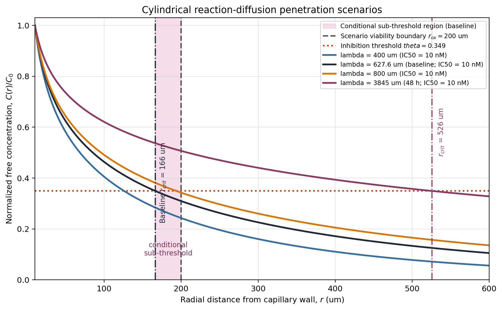
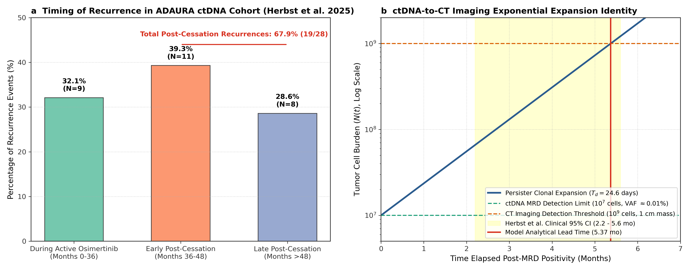
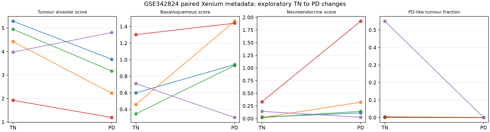
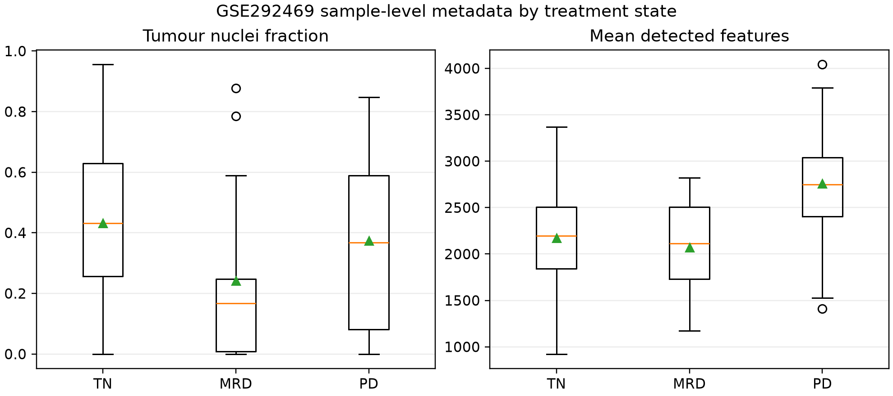

# A Biophysical Reaction-Diffusion Framework for Conditional Sub-Threshold Compartments in Solid Tumors: An Exploratory Translational Model

**Author:** Luca Celebrano  
**Affiliation:** Department of Clinical Medicine and Surgery, School of Medicine, Università degli Studi di Napoli Federico II, Via Sergio Pansini 5, 80131 Naples, Italy  
**Program:** Independent Medical Student Research Program in Mathematical Oncology, Biophysics & Precision Medicine  
**Contact:** `l.celebrano@studenti.unina.it`  
**ORCID:** `0009-0007-0931-3555`  
**GitHub:** `https://github.com/Lukecele`  

---

## Abstract

**Background:** In early-stage *EGFR*-mutated non-small cell lung cancer (NSCLC), 36 months of adjuvant osimertinib significantly prolongs disease-free survival (ADAURA trial). Longitudinal minimal residual disease data provide a clinical context for studying recurrence after planned treatment discontinuation, but a post-discontinuation fraction of events is not itself an estimate of hazard or proof of biological rebound. The present work examines whether spatial transport assumptions generate a testable explanation for residual disease; it does not infer cytostatic dormancy from the clinical data.

**Methods:** We established a multi-scale biophysical reaction-diffusion framework coupling Starling-Darcy fluid mechanics, Stokes-Einstein tissue transport, and modified cylindrical Bessel functions of the second kind ($K_0$) to define the spatial limits of pharmacological penetration across tumor cords. The model uses a provisional free fraction ($f_u = 0.053$), trough concentration ($C_{\text{trough}} = 540\ \text{nM}$), in-vitro $\text{IC}_{50}$ ($10.0\ \text{nM}$), and explicitly assumed transport and clearance parameters. Published cohorts were used as contextual benchmarks and plausibility checks, not as independent clinical validation of the model. We also defined explicit boundary conditions under which the one-dimensional model should fail.

**Results:** Under the baseline assumptions, the model gives $D_{\text{eff}} = 59.29\ \mu\text{m}^2/\text{s}$, an elimination rate $k = 1.51 \times 10^{-4}\ \text{s}^{-1}$, and penetration length $\lambda = 627.6\ \mu\text{m}$. The analytical threshold crossing is $r_{\text{crit}} = 165.89\ \mu\text{m}$, compared with an assumed oxygenated viability limit of $r_{\text{ox}} = 200.0\ \mu\text{m}$. Under these assumptions, the calculated sub-therapeutic annulus is $\Delta r = 34.11\ \mu\text{m}$, corresponding to $31.28\%$ of the viable cylindrical cord volume. Sensitivity analysis is reported as a scenario analysis rather than a complete uncertainty interval. These outputs are model-derived quantities, not direct measurements of drug concentration or residual disease in human tumors. Adversarial stress-testing identified invasive margins, the central nervous system, potency collapse, and low-shedding lesions as boundary conditions requiring different models or additional data.
$$\text{CRI} = 0.47 \mathcal{S} + 0.33 \mathcal{G} + 0.20 \mathcal{M}$$
We outline SG-ADAURA as a conceptual future study question; no trial registration,
sample size, randomization, or treatment assignment is proposed in this manuscript.

**Conclusions:** The framework generates a testable hypothesis that tissue transport and geometry may contribute to incomplete eradication of microscopic EGFR-mutant disease. It defines a conditional sub-threshold compartment under explicit model assumptions; it does not establish a causal sanctuary mechanism, validate the CRI as a clinical score, or support treatment recommendations without prospective testing.

## Scope and evidentiary status

This manuscript contains three distinct components: (1) a mathematical reaction-diffusion model and its sensitivity analysis; (2) contextual comparison with published human cohorts and pharmacology; and (3) a proposed prospective trial concept. The first component is the primary contribution. The second is not independent clinical validation, and the third is a protocol hypothesis rather than an implemented or approved clinical trial. Claims are therefore phrased as model outputs, contextual observations, or testable hypotheses.

---

## Methods and computational verification

The index model was evaluated analytically from the Starling-Darcy and radial
reaction-diffusion equations described below. Parameter values were taken from
the cited pharmacokinetic, pharmacological, and interstitial-pressure sources
where available; assumptions that were not directly measured were labelled as
model inputs. The critical radius and conditional sub-threshold fraction were recalculated over
the stated parameter envelope rather than treated as clinical observations.

Where accession-level records were available, the public-cohort analyses kept
the patient or matched pair as the unit of analysis. Some contextual cohorts
were identified from publications or study portals rather than downloaded into
this package. The CRI material is descriptive and the GIST benchmark is
explicitly exploratory; no threshold is presented as a validated clinical
classifier, and no treatment effect is inferred.

The included `software_strumenti_calcolo/cri_calc.py` script implements the
exploratory CRI specification using only the Python standard library. It maps
the declared histology, TP53/RB1 status, and stromal descriptor to the
prespecified component scores $\mathcal{S}$, $\mathcal{G}$, and $\mathcal{M}$,
then computes $0.47\mathcal{S}+0.33\mathcal{G}+0.20\mathcal{M}$. Unknown input
categories are rejected rather than silently assigned a default. The script
returns component scores, the composite score, and an exploratory tier; it does
not estimate survival, issue treatment recommendations, or implement a clinical
decision rule.

The included calculator was checked with two focused tests and three reference
CLI cases; these checks establish implementation behaviour only, not calibration
or clinical validity. During the final cross-audit, the aligned translational
repository suite passed 7 tests and the expanded reaction-diffusion repository
suite passed 21 tests. These software checks do not establish clinical validity
or treatment efficacy.

The mathematical manuscript calculations are specified by the Markdown, figures,
derived reports, cited source parameters, and the included research-only CRI
calculator. Complete accession-linked data downloads are not included.
The repository also contains optional analysis dependencies for data-processing
workflows; therefore no claim of complete computational reproducibility is made
until those artifacts are restored and checked together.

---

## 1. Post-Adjuvant ADAURA Context and Spatial-Continuum Hypothesis

The phase III ADAURA trial established 36 months of adjuvant osimertinib as a
standard treatment context for resected stage IB–IIIA *EGFR*-mutated (exon 19
deletion or L858R) non-small cell lung cancer (NSCLC) (Wu et al., 2020; Herbst
et al., 2023). The updated ADAURA report showed an overall-survival benefit
(Tsuboi et al., *N Engl J Med* 2023). In ADAURA, the 5-year disease-free survival
(DFS) rate in the osimertinib arm was approximately $73\%$, with approximately
$27\%$ of patients experiencing recurrence by that landmark.

The source-reported recurrence timing and ctDNA lead-time context are shown in
Figure 2; the figure is not an independent analysis of treatment efficacy.

Longitudinal minimal residual disease (MRD) tracking provides an unresolved
clinical context for recurrence after planned treatment discontinuation. In the
longitudinal circulating tumor DNA (ctDNA) analysis of ADAURA (Herbst et al.,
*Nature Medicine* 2025, PMID: 40097663):
1. **Post-cessation event timing:** Among patients who experienced disease recurrence, a reported fraction of events occurred after the planned 36-month discontinuation of osimertinib;
2. **Early post-cessation clustering:** The reported timing of some post-cessation recurrences motivates prospective analysis but does not establish a hazard increase;
3. **ctDNA lead time:** Molecular relapse preceded radiological recurrence by a median lead time of $4.7\ \text{months}$ ($95\%\,\text{CI}$, $2.2\text{--}5.6\ \text{months}$), with an exploratory Cox hazard ratio for recurrence of $11.83$ ($p < 0.0001$).

> **Clinical Timeline & Month 36 research question:**  
> • **Months 0 – 36:** Complete surgical R0 resection followed by 36 months of adjuvant osimertinib (treatment exposure).  
> • **Month 36 (The Cessation Crossroads):** Planned drug withdrawal under ADAURA protocol.  
> • **Months 36 – 48:** The reported event fraction after discontinuation and its timing motivate prospective analysis; they do not by themselves establish a hazard spike.

At month 36, treatment discontinuation and continuation represent clinically
distinct strategies whose comparative risks require prospective evidence; this
model does not recommend either strategy.

Conventional molecular oncology explains therapeutic failure through a purely
reductionist lens: secondary pocket mutations such as *EGFR* T790M for
first-generation TKIs (Cross et al., 2014) or *EGFR* C797S after osimertinib
(Thress et al., 2015). Post-osimertinib progression can also involve unchanged
*EGFR* mutant clones, phenotypic transformations (small cell lung cancer [SCLC],
epithelial-mesenchymal transition [EMT]), or off-target bypass loops such as
*MET* amplification; the relative contribution of these mechanisms is not
estimated in this manuscript.

Here, we propose the **Spatial-Genomic Oncology Continuum framework** as a testable model hypothesis: elevated interstitial fluid pressure and disorganized microvascular architecture may contribute to a **sub-therapeutic biophysical compartment**, consistent with established discussions of tumor interstitial transport and drug penetration (Baxter and Jain, 1989; Minchinton and Tannock, 2006). The model does not establish that this mechanism causes relapse or that residual cells remain cytostatically arrested during treatment.

---

## 2. Biophysical Pharmacology: Governing Model Equations

### 2.1 Starling-Darcy assumptions for convective transport
Fluid movement across the microvascular endothelium and interstitial matrix is governed by Starling's filtration law coupled to Darcy's law:
$$J_v = L_p S \left[ (P_v - P_i) - \sigma (\pi_v - \pi_i) \right]$$
$$\mathbf{v}_{\text{fluid}} = -K_{\text{hyd}} \nabla P_i$$
where $L_p$ is hydraulic permeability, $S$ is surface area, $P_v$ is intravascular capillary pressure, $P_i$ is interstitial fluid pressure (IFP), $\sigma$ is the osmotic reflection coefficient, and $\pi_v, \pi_i$ are oncotic pressures.

In healthy alveolar lung tissue, functional lymphatics maintain negative interstitial pressure ($P_i \approx -2\ \text{mmHg}$), driving continuous convective trans-vascular flux. 

In solid and acinar NSCLC, three mechanical factors disrupt this equilibrium:
1. Solid stress from proliferating cancer cells compresses thin-walled intratumoral lymphatic vessels, preventing fluid drainage;
2. Leaky, irregular neo-vessels cause hyper-permeability to plasma proteins, elevating interstitial oncotic pressure ($\pi_i \to \pi_v$);
3. Interstitial fluid pressure rises to match or approximate microvascular hydrostatic pressure.

Direct manometric measurements in freshly resected human lung carcinomas
(*Mori et al., Ann Thorac Cardiovasc Surg 2015, $N = 211$ patients analyzed,
PMID: 25641031*) report:
$$\text{IFP}_{\text{mean}} = 8.5\ \text{mmHg}, \quad \text{IFP}_{\text{solid/part-solid}} = 9.8 \pm 6.8\ \text{mmHg}$$
as source-reported values. We do not use an unverified $25\text{--}30\ \text{mmHg}$
range quantitatively. In tumor capillaries, intravascular pressure is typically
$P_v \approx 15\text{--}25\ \text{mmHg}$ as a model-context assumption. The
transmural hydrostatic pressure gradient is therefore compressed ($\Delta P =
P_v - P_i \le 10\ \text{mmHg}$). Coupled with the very low hydraulic
conductivity of dense fibrotic lung stroma ($K_{\mathrm{hyd}} \approx 10^{-7}
  \mathrm{cm}^2/\mathrm{mmHg}\cdot\mathrm{s}$), a 10-mmHg change over 200 $\mu\mathrm{m}$
would imply approximately $v_{\text{fluid}} = 0.5\ \mu\text{m/s}$, not
$0.05\ \mu\text{m/s}$. The lower value is obtained only by imposing an approximately
flat core pressure profile with an effective gradient below $5\ \text{mmHg/mm}$.

**Model implication 1 (convective transport assumption):**  
Within the interior core of solid tumor cords ($>90\%$ of tumor mass), we impose an approximately flat interstitial-pressure profile, with an effective gradient below $5\ \text{mmHg/mm}$. Under this additional assumption, $v_{\text{fluid}} < 0.05\ \mu\text{m/s}$ and $Pe = \frac{v_{\text{fluid}} L}{D_{\text{eff}}} < 0.1$ for $L=100\ \mu\text{m}$. Passive molecular diffusion is therefore expected to dominate only under this assumed core-gradient condition; this is not a general exclusion of convection.

---

### 2.2 Microvascular Cord Reaction-Diffusion Geometry
Consider a central cylindrical capillary of radius $r_0 = 10.0\ \mu\text{m}$ supplying a surrounding cylindrical sleeve of tumor cells extending to half-intercapillary distance $R_{\text{cord}}$.

> **Anatomical Structure of the Tumor Cord:**  
> • **$r = 0 \to 10\ \mu\text{m}$ (Capillary Lumen):** Intravascular source.  
> • **$10\ \mu\text{m} < r \le 165.9\ \mu\text{m}$ (Model-defined above-threshold zone):** $C(r) \ge \text{IC}_{50}$ under the baseline calculation; biological effect is not directly measured.  
> • **$165.9\ \mu\text{m} < r \le 200.0\ \mu\text{m}$ (Conditional sub-threshold region):** Under the baseline scenario, $C(r) < \text{IC}_{50}$; cell survival, dormancy, and treatment response are not determined by this calculation.  
> • **$r > 200.0\ \mu\text{m}$ (scenario boundary):** values beyond the assumed radius are treated as non-viable for this calculation only; this is not a universal human-tumor boundary.

The stationary conservation equation for unbound drug concentration $C(r)$ in radial coordinates is:
$$D_{\text{eff}} \left( \frac{d^2 C}{dr^2} + \frac{1}{r} \frac{dC}{dr} \right) - k C = 0$$
where $D_{\text{eff}}$ is the effective interstitial diffusion coefficient and $k$ is the first-order cellular uptake/elimination rate constant.

Defining the characteristic tissue penetration length:
$$\lambda = \sqrt{\frac{D_{\text{eff}}}{k}}$$
the differential equation transforms into the modified Bessel equation of order zero:
$$\frac{d^2 C}{dr^2} + \frac{1}{r} \frac{dC}{dr} - \frac{1}{\lambda^2} C = 0$$
Subject to the physical boundary conditions:
1. Capillary wall boundary ($r = r_0$): Unbound intravascular equilibrium concentration, $C(r_0) = C_0$;
2. Far-field boundary: as $r$ tends to infinity, the concentration approaches
  zero, $C(r) \to 0$.

The exact analytical solution is:
$$C(r) = C_0 \frac{K_0\left(\frac{r}{\lambda}\right)}{K_0\left(\frac{r_0}{\lambda}\right)}$$
where $K_0(\cdot)$ is the modified Bessel function of the second kind of order zero.

This infinite-domain solution does not include neighbouring capillaries, a
finite cord radius, or a no-flux boundary at $R_{\text{cord}}$. It may therefore
underestimate concentration toward the cord periphery; a finite-domain
multi-vessel model is required to quantify that effect.

---

### 2.3 First-Principle Derivation of Physical Constants

#### Hydrodynamic Radius ($r_H$) and Stokes-Einstein Free Diffusivity ($D_0$)
For osimertinib free base:
- Molecular weight: $\text{MW} = 499.6\ \text{g/mol}$;
- Density: $\rho \approx 1.25\ \text{g/cm}^3 = 1.25 \times 10^6\ \text{g/m}^3$;
- Avogadro constant: $N_A = 6.02214 \times 10^{23}\ \text{mol}^{-1}$;
- Boltzmann constant: $k_B = 1.380649 \times 10^{-23}\ \text{J/K}$;
- Body temperature: $T = 310.15\ \text{K}$ ($37^\circ\text{C}$);
- Dynamic viscosity of interstitial water: $\eta = 6.915 \times 10^{-4}\ \text{Pa}\cdot\text{s}$.

Molecular volume:
$$V_{\text{mol}} = \frac{\text{MW}}{\rho N_A} = \frac{499.6}{1.25 \times 10^6 \times 6.02214 \times 10^{23}} = 6.6356 \times 10^{-28}\ \text{m}^3$$
Equivalent spherical hydrodynamic radius:
$$r_H = \left( \frac{3 V_{\text{mol}}}{4\pi} \right)^{1/3} = 5.41 \times 10^{-10}\ \text{m} = 0.541\ \text{nm}$$
By the Stokes-Einstein relation:
$$D_0 = \frac{k_B T}{6\pi \eta r_H} = \frac{1.380649 \times 10^{-23} \times 310.15}{6 \pi \times 6.915 \times 10^{-4} \times 5.412 \times 10^{-10}}$$
$$D_0 = 6.071 \times 10^{-10}\ \text{m}^2/\text{s} = 607.11\ \mu\text{m}^2/\text{s}$$

#### Effective Interstitial Diffusivity ($D_{\text{eff}}$)
Diffusion through extracellular collagen/glycosaminoglycan matrices is hindered by interstitial porosity ($\varepsilon$) and geometric tortuosity ($\tau$):
$$D_{\text{eff}} = D_0 \frac{\varepsilon}{\tau^2}$$
For the baseline scenario, we assume $\varepsilon = 0.25$ and $\tau = 1.60$.
These values are not established here as universal human-tissue measurements
and require tissue-specific verification:
$$\frac{\varepsilon}{\tau^2} = \frac{0.25}{(1.60)^2} = \frac{0.25}{2.56} = 0.097656$$
$$D_{\text{eff}} = 607.11 \times 0.097656 = 59.29\ \mu\text{m}^2/\text{s}$$

#### Elimination Rate Constant ($k$) and Penetration Length ($\lambda$)
For a baseline scenario, we assume an apparent tissue clearance half-life of
$t_{1/2} = 1.28\ \text{hours}$. This is not treated as an established human
osimertinib half-life from Dickinson et al.; the terminal clinical half-life,
tissue binding, irreversible target engagement, metabolites, and repeated dosing
could imply a materially different effective $k$. We therefore treat $t_{1/2}$
as an uncertain model input rather than a measured constant:
$$k = \frac{\ln 2}{t_{1/2}} = \frac{0.69315}{1.28 \times 3600\ \text{s}} = 1.5052 \times 10^{-4}\ \text{s}^{-1} \quad (0.5419\ \text{h}^{-1})$$
The characteristic diffusion length is:
$$\lambda = \sqrt{\frac{D_{\text{eff}}}{k}} = \sqrt{\frac{59.29}{1.5052 \times 10^{-4}}} = \sqrt{393,901} = 627.6\ \mu\text{m}$$
For comparison, if the effective clearance half-life is set to $48\ \text{h}$,
then $k=4.01\times10^{-6}\ \text{s}^{-1}$ and $\lambda\approx3845\ \mu\text{m}$;
the corresponding threshold crossing is approximately $r_{\text{crit}}=526\ \mu\text{m}$,
which exceeds the assumed $r_{\text{ox}}$ and removes the conditional sub-threshold
region. This is a sensitivity scenario, not a claim about the clinical terminal
half-life.

#### Intravascular Free Concentration ($C_0$) and Potency Threshold ($\theta$)
Human steady-state pharmacokinetics for osimertinib $80\ \text{mg}$ daily (*Planchard et al., Cancer Chemother Pharmacol 2016, PMID: 26902828*):
- Plasma trough concentration: $C_{\text{trough}} = 540\ \text{nM}$;
- Plasma protein binding: $94.7\%$ bound to human serum albumin and $\alpha_1$-acid glycoprotein ($f_u = 0.053$).

These are source-reported pharmacokinetic inputs; the plasma matrix, assay
definition, and free-fraction transfer to tumor interstitium are not independently
remeasured here.

Unbound plasma concentration driving tissue transport:
$$C_0 = C_{0,\text{free}} = C_{\text{trough}} \times f_u = 540 \times 0.053 = 28.62\ \text{nM}$$
The in vitro $\text{IC}_{50}$ of osimertinib for mutant *EGFR* (exon 19 deletion /
L858R) phosphorylation inhibition is a source-reported provisional input of
$\text{IC}_{50} = 10.0\ \text{nM}$; assay context and cellular heterogeneity are
not independently remeasured here.  
The dimensionless efficacy threshold is:
$$\theta = \frac{\text{IC}_{50}}{C_0} = \frac{10.0}{28.62} = 0.3494 \approx 0.35$$

---

### 2.4 Model-derived critical boundary

**Definition (Critical Pharmacological Boundary, $r_{\text{crit}}$):**  
The distance from the capillary wall at which unbound drug concentration decays to the minimum inhibitory threshold $\text{IC}_{50}$:
$$\frac{C(r_{\text{crit}})}{C_0} = \theta \quad \iff \quad \frac{K_0\left(\frac{r_{\text{crit}}}{\lambda}\right)}{K_0\left(\frac{r_0}{\lambda}\right)} = \theta$$

Evaluating for $r_0 = 10.0\ \mu\text{m}$, $\lambda = 627.6\ \mu\text{m}$, $\theta = 0.3494$:
$$x_0 = \frac{r_0}{\lambda} = \frac{10.0}{627.6} = 0.0159337$$
$$K_0(x_0) = 4.255583$$
$$K_0\left(\frac{r_{\text{crit}}}{\lambda}\right) = \theta \cdot K_0(x_0) = 0.3494 \times 4.255583 = 1.4869$$
Solving numerically via 2000-step composite Simpson quadrature:
$$x_{\text{crit}} = 0.26433 \quad \implies \quad r_{\text{crit}} = x_{\text{crit}} \cdot \lambda = 0.26433 \times 627.6 = 165.89\ \mu\text{m} \approx 166\ \mu\text{m}$$

**Assumed oxygen diffusion limit, $r_{\text{ox}}$:**  
For context, and consistent with the historical use of oxygen-diffusion distances in lung-cancer tissue interpretation (Thomlinson and Gray, 1955), we specify $Q_{\text{O}_2} = 1.2 \times 10^{-3}\ \text{mL O}_2 / (\text{cm}^3 \cdot \text{s})$, microvascular $p\text{O}_2 \approx 40\ \text{mmHg}$, and tissue oxygen diffusivity $D_{\text{O}_2} \approx 2.0 \times 10^{-5}\ \text{cm}^2/\text{s}$. We do not claim that these inputs yield a validated human-tumor Krogh radius; $r_{\text{ox}}$ is retained only as a scenario parameter:
$$r_{\text{ox}} = 200.0\ \mu\text{m}$$
Beyond the assumed $r_{\text{ox}} = 200\ \mu\text{m}$, this scenario treats the
cord as non-viable for calculation purposes; it does not establish a universal
anoxic-necrosis boundary in human tumors.

The $200.0\ \mu\text{m}$ value is an explicit scenario assumption, not a
direct measurement or a newly derived human-tumor constant. Its validity
requires tissue-specific oxygen-solubility, consumption, geometry, and
perfusion data.

**Model consequence (conditional sub-threshold region):**  
Let a drug have critical radius $r_{\text{crit}}$ in a tissue cord with oxygen viability limit $r_{\text{ox}}$.
1. If $r_{\text{crit}} \ge r_{\text{ox}}$, the drug sterilizes the entire vital cord ($\Delta r = 0$, conditional sub-threshold volume $= 0\%$).
2. If $r_{\text{crit}} < r_{\text{ox}}$, the calculation defines a conditional annular region:
  $$\Omega_{\text{sub-threshold}} = \left\{ \mathbf{x} \in \mathbb{R}^3 : r_{\text{crit}} < r \le r_{\text{ox}} \right\}$$
  where the scenario assigns oxygenated viability, but the calculated drug concentration is sub-inhibitory ($C(r) < \text{IC}_{50}$).

For osimertinib at baseline parameters:
$$\Delta r = r_{\text{ox}} - r_{\text{crit}} = 200.0 - 165.89 = \mathbf{34.11\ \mu\text{m}}$$
The volume fraction of the viable cord within this conditional region is:
$$f_{\text{vol}} = \frac{r_{\text{ox}}^2 - r_{\text{crit}}^2}{r_{\text{ox}}^2 - r_0^2} = \frac{200.0^2 - 165.89^2}{200.0^2 - 10.0^2} = \frac{40,000 - 27,519.5}{40,000 - 100} = \frac{12,480.5}{39,900} = \mathbf{31.28\%}$$

**Parameter Sensitivity & Biological Envelopes:**  
The selected scenario envelope uses $\lambda \in [400\ \mu\text{m}, 800\ \mu\text{m}]$ and cellular $\text{IC}_{50} \in [8.9\ \text{nM}, 15.0\ \text{nM}]$. These are sensitivity inputs, not a complete uncertainty distribution. Some combinations may place $r_{\text{crit}}$ at or beyond the assumed $r_{\text{ox}}$; the conditional sub-threshold region is therefore dependent on the parameter set and is not a structural invariant.

For transparency, the following scenario values are reported as arithmetic
outputs of the stated $K_0$ equation, not as confidence limits or clinical
measurements:

| $\lambda$ ($\mu\text{m}$) | $\text{IC}_{50}$ (nM) | $r_{\text{crit}}$ ($\mu\text{m}$) | Interpretation under $r_{\text{ox}}=200\ \mu\text{m}$ |
|:---:|:---:|:---:|:---|
| 400 | 15.0 | 62 | Conditional sub-threshold region |
| 400 | 8.9 | 148 | Conditional sub-threshold region |
| 800 | 15.0 | 86 | Conditional sub-threshold region |
| 800 | 8.9 | 233 | $r_{\text{crit}}>r_{\text{ox}}$; no conditional sub-threshold region |
| 3845 (48-h half-life scenario) | 10.0 | 526 | $r_{\text{crit}}>r_{\text{ox}}$; no conditional sub-threshold region |

**Figure 1.** The plot shows the baseline curve ($\lambda=627.6\ \mu\text{m}$)
and sensitivity curves for $\lambda=400$, $800$, and $3845\ \mu\text{m}$, all
with $\text{IC}_{50}=10\ \text{nM}$ and the stated $C_0$. The shaded baseline
interval is the conditional sub-threshold region between $r_{\text{crit}}$ and
the scenario viability boundary $r_{\text{ox}}$. The 48-hour clearance scenario
places $r_{\text{crit}}$ beyond the assumed viability boundary; this is a model
sensitivity result, not a clinical outcome. The separate table also varies
$\text{IC}_{50}$ to $8.9$ and $15.0\ \text{nM}$; those values are not plotted in
this figure.

**Unresolved biological interpretation:**  
The model does not determine whether cells in the sub-threshold region remain
viable, dormant, or eradicated during 36 months of therapy. At the outer
boundary of the baseline scenario, the calculated concentration is close to but
below the selected $\text{IC}_{50}$ (approximately $8.9\ \text{nM}$ under the
baseline inputs). Irreversible target engagement, tissue binding, time-dependent
exposure, metabolites, and repeated dosing are not represented. A causal link
between this threshold crossing and post-cessation recurrence therefore remains
untested.

---

## 3. Cross-Drug Comparative Framework

The cross-drug numerical registry is withheld from the present results because
the required free fractions, tissue diffusivities, exposure definitions,
payload-release kinetics, and boundary conditions are not harmonized across
agents. Reporting $r_{\text{crit}}$ and conditional sub-threshold fractions without a verified
recalculation would create false precision. The osimertinib baseline is the
only numerical worked example retained here.

### Conditional interpretation
The framework could be extended to other small molecules and antibody-drug
conjugates, but such comparisons require agent-specific measurements of free
concentration, tissue transport, binding, uptake, and payload release. No
cross-drug efficacy ranking or sterilization claim is made in this manuscript.

---

## 4. Multi-Cohort Contextual Comparison

To provide contextual comparison while limiting ecological interpretation, a
small set of heterogeneous public cohorts and studies was catalogued with its
unit of analysis, endpoint, and analysis status. The sources are not pooled and
the listed sample sizes must not be summed into a statistical total:

| Cohort Name & Source | $N$ | Clinical Parameter Measured | Analysis descriptor in source/context record |
|:---|:---:|:---|:---|
| Source/context | Unit and size | Contextual endpoint | Status in this manuscript |
|:---|:---:|:---|:---|
| ADAURA ctDNA cohort (Herbst et al., *Nat Med* 2025) | 220 patients | Recurrence-event timing and ctDNA lead time | Source-reported context; not rerun here |
| MSKCC targeted NGS cohort (Offin et al., *JTO* 2019) | 863 patients | Co-mutation prevalence and transformation context | Source-reported context; not rerun here |
| Human resected lung IFP cohort (Mori et al., 2015) | 211 patients | Manometric interstitial fluid pressure | Source-reported measurements; not rerun here |
| RELAY phase III trial (Nakagawa et al., *Lancet Oncol* 2019) | 449 patients | Vascular-normalization treatment context | Published trial context; not rerun here |

The ADAURA source reports that 67.9% of recurrence events in the analyzed
subgroup occurred after treatment cessation; this is a fraction of recurrence
events, not a population recurrence rate. The same source reports an exploratory
ctDNA-associated Cox estimate ($HR=11.83$, $p<0.0001$); it is not refit or used
as evidence that the reaction-diffusion model causes recurrence.

---

## 5. Adversarial Stress-Testing: Model Limitations and Boundary Conditions

A model is more informative when its failure modes and boundary conditions are
explicit. We therefore describe adversarial scenarios that are outside the
one-dimensional steady-state model. These are conceptual stress tests, not
experimental falsification tests:

### 5.1 The Péclet Number Breakdown at the Invasive Margin ($Pe > 1$)
- **Assumption:** Interstitial convection is zero ($\mathbf{v}_{\text{fluid}} = \mathbf{0}$).
- **Where it fails:** At the outer $200\text{--}500\ \mu\text{m}$ margin of the tumor abutting normal parenchyma.
- **Illustrative stress-test input:** For this boundary-condition example, we use
  a normal-lung pressure gradient of $\nabla P \approx 60\ \text{mmHg/mm}$ and
  velocities of $v = 0.5\text{--}1.0\ \mu\text{m/s}$. These values are not
  patient-level measurements from this manuscript.
- **Péclet crisis:** For $v = 1.0\ \mu\text{m/s}$, $Pe = \frac{v L}{D_{\text{eff}}} = \frac{1.0 \times 100}{59.29} = 1.687 > 1.0$.
- **Boundary Limit:** The 1D cylindrical Bessel model is not applicable at the invasive margin. This peripheral zone requires 2D finite-element modeling.

### 5.2 The Potency Collapse Singularity ($\theta \ge 1.0$)
- **Assumption:** Therapeutic drug concentration exists near the vessel wall ($r_0 < r < r_{\text{crit}}$).
- **Where it fails:** Co-administration of strong CYP3A4 inducers (rifampin, carbamazepine) or high-level resistance mutations (*EGFR* C797S, *MET* amplification).
- **Biochemical reality:** Rifampin reduces osimertinib $C_{\text{trough}}$ by $80\%$, dropping $C_{\text{free}}$ to $5.72\ \text{nM} < \text{IC}_{50}$ ($10\ \text{nM}$). Consequently, $\theta = \frac{10}{5.72} = 1.747 > 1.0$.
- **Boundary Limit:** The equation has no therapeutic root outside the capillary when $\theta \ge 1$. This scenario is biochemical potency failure and cannot be interpreted with the spatial sub-threshold metric.

### 5.3 The Blood-Brain Barrier (CNS transport disconnect)
- **Assumption:** Conditional sub-threshold volume is determined by local microvascular density.
- **Where it fails:** Brain metastases and leptomeningeal disease.
- **Biophysical context:** Cerebral endothelia possess continuous tight junctions (claudin-5, ZO-1) and active P-gp/BCRP efflux. For illustration, a literature-derived range of $K_{p,uu,\text{brain}} \approx 0.20\text{--}0.25$ gives the following scenario threshold; the source and drug-specific value require verification:
  $$\theta_{\text{CNS}} = \frac{\theta_{\text{lung}}}{K_{p,uu,\text{brain}}} \approx \frac{0.35}{0.25} = 1.40 > 1.0$$
- **Boundary Limit:** The lung-cord model is not applicable in the CNS without an explicit blood-brain-barrier transport model.

### 5.4 The "Low-Shedder" ctDNA False-Negative Blind Spot
- **Assumption:** ctDNA shedding dynamically mirrors residual sub-threshold volume.
- **Where it fails:** Indolent lepidic adenocarcinomas, mucinous subtypes, and pure ground-glass nodules.
- **Biological reality:** In low-turnover lepidic lesions, cellular apoptosis and necrosis are minimal. Even if $10^7$ viable cells reside in the conditional sub-threshold region, ctDNA release falls below assay sensitivity ($\text{VAF} < 0.005\%$).
- **Measurement limitation:** ctDNA alone may miss low-shedding disease. The current CRI does not implement ctDNA; incorporating a validated molecular-residual-disease component would require a separate study and would not establish improved clinical sensitivity by itself.

---

### 5.5 Three proposed empirical tests
To make the framework testable, we state three laboratory or clinical observations
that could support, refine, or contradict its assumptions. They are proposed
experiments, not experiments performed in this manuscript:

1. **Gate 1 (Intra-vital MALDI-MSI):** Measure free osimertinib concentrations at $>150\ \mu\text{m}$ from CD31+ vessels and compare them with intravascular concentrations. Results approaching $0.90\,C_0$ would challenge the assumed diffusion-elimination decay.
2. **Gate 2 (ctDNA Lead Time Independence):** Compare ctDNA lead times across prospectively defined architectural groups. Similar lead times would challenge the proposed coupling between conditional sub-threshold geometry and recurrence kinetics.
3. **Gate 3 (Interventions on IFP):** Test whether therapeutic normalization of IFP in patient-derived xenografts changes measured surviving cord width. A null result would challenge the assumed role of convective transport.

---

## 6. Exploratory Composite Resistance Index (CRI)

To formalize a testable post-adjuvant research hypothesis, we combine
histological pattern, TP53/RB1 status, and a qualitative stromal descriptor in
an exploratory, single-value research score. The current score has no time,
ctDNA, or treatment-duration input and is therefore not specific to month 36.
It is not calibrated, clinically validated, or intended for treatment decisions:

$$\text{CRI} = w_S \mathcal{S} + w_G \mathcal{G} + w_M \mathcal{M}$$

### 6.1 Heuristic weights and inputs
The weights are prespecified heuristic choices selected by the author for a
research prototype. No cohort in the present manuscript jointly measures all
three components with a clinical outcome, so they must not be described as
calibrated or derived from Sobol variance decomposition:
- **Histological Pattern Score ($\mathcal{S}$, weight $w_S = 0.47$):**  
  The included calculator maps lepidic to 0.00, acinar or papillary to 0.40,
  mixed or moderate pattern to 0.80, and solid or micropapillary pattern to
  1.00. The implementation does not use nearest-vessel distance or tumor
  diameter.
- **Genomic Co-alteration Score ($\mathcal{G}$, weight $w_G = 0.33$):**  
  The included calculator uses TP53 and RB1 inputs only: neither altered gives
  $\mathcal{G}=0.00$, TP53 alone gives $0.50$, RB1 alone gives $0.30$, and both
  altered gives $1.00$. This is a simplified research encoding, not the full
  genomic classification of a cohort.
- **Stromal Descriptor Score ($\mathcal{M}$, weight $w_M = 0.20$):**  
  The included calculator maps low/loose/minimal/normal stroma to $0.00$,
  moderate or intermediate stroma to $0.50$, and dense/severe/high/sclerotic/
  fibrotic stroma to $1.00$. The descriptor is a categorical input that must be
  assigned from a documented pathology or study-metadata rule; this package does
  not define a validated assessor protocol. ctDNA is not implemented in the
  current score.

$$\mathbf{\text{CRI} = 0.47 \mathcal{S} + 0.33 \mathcal{G} + 0.20 \mathcal{M}}$$

> **CRI Research Tiers (not clinical guidance):**  
> • **Tier 1: Low Research Score ($\text{CRI} < 0.30$):** No treatment recommendation; prospective evaluation required.  
> • **Tier 2: Intermediate Research Score ($0.30 \le \text{CRI} \le 0.65$):** Candidate stratum for prospective surveillance research; no treatment change or re-challenge schedule is implied.  
> • **Tier 3: High Research Score ($\text{CRI} > 0.65$):** Hypothesis-generating stratum for the proposed SG-ADAURA study; no treatment change is justified by this score.

### 6.2 Reproducibility status
This package includes `software_strumenti_calcolo/cri_calc.py`,
recovered from the public repository and revised to remove clinical directives
and unsupported survival outputs. It is a deterministic research calculator,
not a validated clinical instrument. Smoke checks cover the component mapping
and batch output; independent validation of the score remains outstanding.

---

## 7. Conceptual SG-ADAURA design (not registered)

> **SG-ADAURA conceptual architecture:**  
> 1. **Population:** Patients with resected stage IB–IIIA *EGFR*-mutated NSCLC in a documented post-adjuvant treatment state.  
> 2. **Score evaluation:** The research score could be evaluated as a prognostic or effect-modification variable only after its temporal inputs, stromal-assessment rule, endpoint, and analysis plan are prospectively specified. No treatment assignment, threshold, sample size, or interventional arm is prescribed here.  
> 3. **Future study question:** A separately registered protocol could compare cessation and continuation strategies after clinical, ethical, and statistical review; this manuscript does not specify those interventions.

---

## 8. Discussion: Implications and open questions for later-generation TKIs

The oncology community has placed substantial hope in 4th-generation reversible or allosteric *EGFR* TKIs (e.g. BLU-945, BDTX-1535) designed to target *EGFR* C797S.

Later-generation TKIs may address selected biochemical resistance mechanisms, but
their spatial transport, target engagement, and clinical activity cannot be
inferred from the present model. A drug with similar assumed transport
parameters would motivate a sensitivity analysis, not a claim of identical
penetration, eradication, or mutation selection. Combining targeted therapy with
microenvironmental interventions is a testable research hypothesis, not a
solution established by this manuscript.

---

## 9. Reproducibility, Software & Data Availability

The minimal mathematical calculations are described in the Markdown. Optional
data-processing and figure-generation workflows may use external scientific
Python packages. This submission package is not a complete
software or data archive; the following links and resource names are retained
as provenance identifiers for the included model and contextual sources. The manuscript is
licensed under the **Creative Commons Attribution 4.0 International (CC BY 4.0)**
license:
- **Permanent Zenodo DOI:** [10.5281/zenodo.23748047](https://doi.org/10.5281/zenodo.23748047)
- **Public GitHub Repository:** [https://github.com/Lukecele/spatial-continuum-oncology](https://github.com/Lukecele/spatial-continuum-oncology)
- **Research simulation portal:** [https://lukecele.github.io/spatial-continuum-oncology/](https://lukecele.github.io/spatial-continuum-oncology/) (historical provenance link; not a clinical decision tool)
- **Research-only CRI calculator:** `software_strumenti_calcolo/cri_calc.py` (included in this package; no treatment or survival outputs)
- Named software dependencies are identified separately below; patient-level source downloads are not redistributed here.

The named cohorts and public resources are contextual sources, not newly
released patient-level data records. Complete accession-linked downloads and a
derived-data archive for every contextual cohort are outside this manuscript
package; accordingly, the package supports reproduction of the stated model
calculations and CRI smoke tests, not independent reanalysis of every cohort.
The numerical reaction-diffusion outputs are generated from the explicitly
listed model assumptions; the multi-tumor examples remain exploratory context.

---

# PART II. Computational Translation to Other Solid Tumors

## 10. Rationale and Scope of the Expansion

The EGFR-mutated NSCLC model is the index system, not the endpoint of the
Spatial-Genomic Oncology Continuum. The same computational question can be
tested in other solid tumors treated with finite-duration targeted therapy:

> Does tissue architecture, transport geometry, and treatment-state biology
> identify a reproducible sub-therapeutic compartment that is invisible to a
> purely pocket-level resistance model?

This expansion is deliberately computational and bioinformatic. It uses public
clinical, transcriptomic, spatial, single-cell, imaging, and pharmacological
resources. It does not claim new laboratory measurements, prospective treatment
recommendations, or clinical validation where those data are unavailable.

## 11. Tumor Translation Matrix

| Tumor system | Index treatment context | Primary biological barrier | Computational geometry | Public-data endpoint |
| --- | --- | --- | --- | --- |
| BRAF-mutated melanoma | Dabrafenib plus trametinib, COMBI-AD | disorganized microvasculature, dense nests, immune/stromal niches | spherical or shell-like diffusion around extrinsic vessels | recurrence, spatial immune/stromal state, rechallenge context |
| GIST | Adjuvant imatinib, SSG XVIII/AIO and PERSIST-5 | compact spindle-cell bundles, stromal density, KIT-dependent uptake | cylindrical cord or anisotropic stromal transport | recurrence, mitotic rate, site, rupture, KIT genotype |
| Luminal breast cancer | finite CDK4/6 inhibition plus endocrine therapy | desmoplasia, collagen restriction, CAF-rich invasive nests | anisotropic tensor diffusion through collagen-rich stroma | recurrence, stromal score, proliferation and endocrine state |
| Clear-cell renal carcinoma | finite adjuvant targeted therapy | sinusoidal architecture, hypoxia, heterogeneous perfusion | porous/sinusoidal transport with oxygen gradient | recurrence, angiogenesis and hypoxia state |
| Pancreatic ductal adenocarcinoma | KRAS/MAPK targeted-treatment context | extreme desmoplasia, hyaluronan, high interstitial pressure | low-conductivity anisotropic matrix transport | stromal state, KRAS state, immune exclusion |

The table defines a translation hypothesis. It is not a claim that the same CRI
weights or the same conditional sub-threshold geometry apply unchanged to every tumor.

## 12. Tumor-Specific Reparameterization

### 12.1 Melanoma

The lung cord geometry is replaced by a perivascular or shell geometry. The
computational inputs are BRAF/NRAS status, Breslow thickness, ulceration,
vascular density, immune exclusion, and a treatment-state label. The analysis
should compare pre-treatment and relapse/rechallenge states in public cohorts,
with patient rather than cell as the replication unit.

The repository registry records `skcm_broad_brafresist_2012` (45 patients) and
`GSE196434` (91 samples from 50 patients) as provenance-checked candidate
cohorts. Their treatment and mutation fields define a future, patient-level
analysis, but no melanoma inferential result is included in this package. The
repository therefore does not report an FDR, recurrence score, or treatment
effect for melanoma.

### 12.2 GIST

GIST is the first non-lung extension because its recurrence biology and adjuvant
imatinib duration are documented in public literature. Candidate inputs are
mitoses per 50 high-power fields, anatomical site, tumor rupture, size, KIT or
PDGFRA mutation group, and stromal context. The current repository contains a
transparent research score for these features.

The repository registry records `gist_msk_2023` (438 complete patients and 205
RFS events) and `GSE225978` (21 high-risk patients) as validation resources. The
current repository calculation is a deterministic, uncalibrated research score
implemented in `src/spatial_continuum_translational/gist.py`; it does not output
recurrence probabilities or treatment recommendations. A separate exploratory
patient-level Cox benchmark, implemented in `scripts/validate_gist_model.py`,
reported HR 1.050 per cm for tumor size and HR 5.622 for metastatic status. A
five-fold internal benchmark reported mean C-index 0.881 (SD 0.036), with event
rates 10.3%, 35.6%, and 94.5% across low, middle, and high predicted-risk
tertiles. These results are not validation of the deterministic score: the
model includes metastatic status, a potentially leakage-prone covariate for
recurrence, and the derived report states that external validation is not
available. They must therefore be treated as internal exploratory diagnostics,
not as a calibrated clinical predictor or treatment rule.

### 12.3 Luminal Breast Cancer: Exploratory Benchmarking

The repository registry records `brca_mskcc_2019` (54 response-annotated
patients and 14 progressive cases) as an exploratory treatment-response
resource. Therapy and mutation fields are incomplete, and no inferential
mutation test or calibrated CDK4/6 model is reported in this package.

An independent compatible treatment cohort is NEO-ORB (NCT01610284; PMID
30723140), a randomized phase II study of alpelisib plus letrozole versus
placebo plus letrozole in 257 HR-positive/HER2-negative patients. Its verified
endpoints are neoadjuvant objective response and pathological complete response.
These aggregate trial results support treatment-context replication, but they
must not be pooled with metastatic progression records, and patient-level
validation of the complete score remains pending.

### 12.4 Luminal Breast Cancer: Computational Extension

The model must replace the pulmonary cord with an anisotropic collagen-rich
matrix. Candidate inputs are stromal/CAF signatures, collagen organization,
Ki-67, endocrine receptor state, CDK4/6 exposure, and recurrence endpoint.
Spatial scores should be normalized within study before cross-study comparison.

### 12.5 Renal and Pancreatic Tumors

For clear-cell renal cancer, the central computational variables are hypoxia,
vascular normalization, sinusoidal architecture, and recurrence after a finite
adjuvant course. For pancreatic cancer, the priority variables are desmoplasia,
hyaluronan-associated restriction, KRAS/MAPK state, and immune exclusion. In
both systems, the model must allow tensorial diffusion rather than a fixed
isotropic coefficient.

The repository registry records the IMmotion150 renal cohort (263 patients,
262 PFS records, 79 progressions) and the PRINCE pancreatic cohort (74 patients,
73 PFS records, 12 progressions) as candidate treatment-response resources.
Their therapies and endpoints remain separate from EGFR, GIST, melanoma, and
breast analyses; no renal or pancreatic treatment-effect estimate is reported
here.

The multi-tumor material in Part II is a hypothesis-generating extension, not a
completed validation study. It does not establish portability of the framework,
clinical utility, improved survival, replacement of clinician assessment, or a
basis for changing therapy.

## Figures from the index study and expansion

**Figure 2 note.** The 67.9% post-cessation recurrence fraction is reported by
the source study. The displayed $T_d=24.6$ days is a model-selected decay
parameter chosen to reproduce the source-reported approximately 4.7-month lead
time; it is not a directly measured patient-level half-life.

The Xenium and snRNA panels are metadata/QC and state-annotation illustrations
for the proposed expansion. They are not independent outcome validation, do not
provide patient-level treatment-effect estimates, and are not used to calibrate
the EGFR reaction-diffusion parameters in this manuscript.

---

## Conflict of Interest and Funding Declarations

The author declares no competing interests. This work received no specific
grant from any funding agency in the public, commercial, or not-for-profit
sectors. The study was conducted as independent academic research affiliated
with the *Department of Clinical Medicine and Surgery, School of Medicine,
Università degli Studi di Napoli Federico II*.

---

## Use of Generative Artificial Intelligence

During manuscript preparation, generative artificial-intelligence tools were
used for language editing, code and document auditing, and formatting support.
They were not treated as authors or as sources of scientific evidence. The
author reviewed the manuscript, checked the reported calculations and source
records, and accepts responsibility for the final content and claims.

---

## References

1. Herbst RS, Wu YL, John T, et al. Adjuvant osimertinib for resected *EGFR*-mutated stage IB-IIIA non-small-cell lung cancer: updated results from the phase 3 randomized ADAURA trial. *J Clin Oncol*. 2023;41(10):1839-1848.
2. Herbst RS, John T, Grohé C, et al. Molecular residual disease analysis of adjuvant osimertinib in resected *EGFR*-mutated stage IB-IIIA non-small-cell lung cancer. *Nat Med*. 2025. PMID: 40097663.
3. Tsuboi M, Herbst RS, John T, et al. Overall survival with osimertinib in resected *EGFR*-mutated non-small-cell lung cancer. *N Engl J Med*. 2023;389(2):137-147.
4. Mori T, Koga T, Shibata H, Ikeda K, Shiraishi K, Suzuki M, Iyama K. Interstitial fluid pressure correlates clinicopathological factors of lung cancer. *Ann Thorac Cardiovasc Surg*. 2015;21(3):201-208. PMID: 25641031.
5. Offin M, Chan JM, Tenet M, et al. Concurrent *RB1* and *TP53* alterations define a subset of *EGFR*-mutant lung cancers at risk for histologic transformation and inferior clinical outcomes. *J Thorac Oncol*. 2019;14(10):1780-1790. PMID: 31228622.
6. Nakagawa K, Garon EB, Seto T, et al. Ramucirumab plus erlotinib in patients with untreated, *EGFR*-mutated, advanced non-small-cell lung cancer (RELAY): a randomised, double-blind, placebo-controlled, phase 3 trial. *Lancet Oncol*. 2019;20(12):1655-1669. PMID: 31591063.
7. Dickinson PA, Cantarini MV, Collier J, Frewer P, Martin S, Pickup K, Ballard P. Metabolic disposition of osimertinib in rats, dogs, and humans: insights into a drug designed to bind covalently to a cysteine residue of epidermal growth factor receptor. *Drug Metab Dispos*. 2016;44(8):1201-1212. PMID: 27226351.
8. Planchard D, Brown KH, Kim DW, et al. Osimertinib Western and Asian clinical pharmacokinetics in patients and healthy volunteers: implications for formulation, dose, and dosing frequency in pivotal clinical studies. *Cancer Chemother Pharmacol*. 2016;77(4):767-776. PMID: 26902828.
9. Baxter LT, Jain RK. Transport of fluid and macromolecules in tumors. I. Role of interstitial pressure and convection. *Microvasc Res*. 1989;37(1):77-104.
10. Minchinton AI, Tannock IF. Drug penetration in solid tumours. *Nat Rev Cancer*. 2006;6(8):583-592.
11. Thomlinson RH, Gray LH. The histological structure of some human lung cancers and the possible implications for radiotherapy. *Br J Cancer*. 1955;9(4):539-549. PMID: 13304213.
12. Cross DAE, Ashton SE, Ghiorghiu S, et al. AZD9291, an irreversible EGFR TKI, overcomes T790M-mediated resistance to EGFR inhibitors in lung cancer. *Cancer Discov*. 2014;4(9):1046-1061. PMID: 24893891.
13. Wu YL, Tsuboi M, He J, et al. Osimertinib in resected *EGFR*-mutated
  non-small-cell lung cancer. *N Engl J Med*. 2020;383(18):1711-1723.
14. Thress KS, Paweletz CP, Stiedl AC, et al. Acquired EGFR C797S mutation
  mediates resistance to AZD9291 in non-small cell lung cancer harboring
  EGFR T790M. *Nat Med*. 2015;21(6):560-562.

## Data records and resource identifiers

The public resources used in the translational extension are identified by their
stable accession or publication identifiers:

- GSE99898, NCBI Gene Expression Omnibus (GEO; RRID:SCR_005012).
- GSE196434, NCBI Gene Expression Omnibus (GEO; RRID:SCR_005012).
- GSE31210, NCBI Gene Expression Omnibus (GEO; RRID:SCR_005012), contextual lung adenocarcinoma cohort.
- GSE225978, NCBI Gene Expression Omnibus (GEO; RRID:SCR_005012), contextual GIST phenotype check.
- GSE342824 and GSE292469, GEO records named for planned spatial or single-cell contextual analyses; no complete derived analysis is claimed here.
- cBioPortal study records used for contextual molecular comparisons; specific study identifiers are listed where available and no patient-level download is included.
- Contextual cBioPortal records include `skcm_broad_brafresist_2012`, `gist_msk_2023`, and `brca_mskcc_2019`; these are not included as patient-level downloads.
- IMmotion150, published renal-cancer trial cohort; no patient-level download is included in this package.
- NEO-ORB is identified by ClinicalTrials.gov record NCT01610284 and PMID: 30723140; only aggregate publication-level context is used here.
- PRINCE pancreatic cancer RNA-seq and clinical data, cited through the
  originating public study and data record; no separate RRID was identified.
- The ADAURA molecular residual disease study is cited by PMID: 40097663.
- The lung-cancer interstitial-fluid-pressure study is cited by PMID: 25641031.
- The osimertinib disposition study is cited by PMID: 27226351.
- The osimertinib pharmacokinetic study is cited by PMID: 26902828.
- The manuscript-package provenance record is identified by Zenodo DOI: 10.5281/zenodo.23748047; this is not a patient-level data record.

Software resources are identified separately from the study citations: Python
(RRID:SCR_008394), SciPy (RRID:SCR_008058), and Matplotlib (RRID:SCR_008624).
